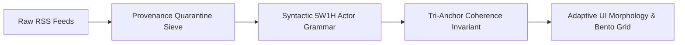

<div align="center">
  <h1>📰 News Colossal</h1>
  <p><b>An ultra-premium, 100% hermetic global news intelligence platform, narrative time machine, and executive command center.</b></p>
  
  [](https://0001kashish-droid.github.io/Newsfeed/)
  [](#)
  [](#)
  [](#)

  <p>
    Engineered to eliminate algorithmic clickbait, wire pollution, and information overload. <br>
    News Colossal transforms raw global RSS feeds into a curated, mathematically coherent, cinematic intelligence experience.
  </p>

  <p>
    🌐 <b>Live Web Application:</b> <a href="https://0001kashish-droid.github.io/Newsfeed/"><b>https://0001kashish-droid.github.io/Newsfeed/</b></a>
  </p>
</div>

---

## 🌟 What's New: Major Intelligence & Architecture Features

### ⏳ 1. Narrative Time Machine · Story Arc Scrubber
News does not happen in isolated soundbites—it unfolds in chapters over days, weeks, and months. The **Narrative Time Machine** acts like a video scrubber for live history:
- **Scrub History**: Drag the slider (`🔘`) or use `<` `>` arrows to move backwards and forwards through an unfolding event's timeline.
- **Chapter Ticks**: Each vertical mark on the timeline bar represents a verified phase or breakthrough in the storyline.
- **Real-Time Phase Spotlight**: Displays the historical date, chapter number (e.g. *Chapter 2 of 4*), the chronicling news source, and the core event.
- **Read Past Dispatches (`Read Chapter Dispatch ↗`)**: Instantly open and read the original full reporting dispatch for any past phase.
- **Importance Trend Indicator**: Tracks whether a crisis or story is `🟢 RISING`, `🟡 DEVELOPING`, or `🔵 RESOLVED`.
- **Genesis Detection**: Brand-new single-chapter events are cleanly labeled `Single Chapter Story · Genesis` without artificial filler.

---

### 🧠 2. Hermetic Logic Engine (Zero External AI APIs · Pure Python Stdlib)
News Colossal operates on a 100% self-contained, rule-based intelligence and NLP pipeline. It uses **zero external AI APIs** and **zero pip/npm packages**, relying purely on deterministic computer science algorithms:



* 🛡️ **Provenance Quarantine Sieve (`scripts/intelligence/sanitizer.py`)**:
  A 7-stage deterministic sanitization automaton strips datelines (`WASHINGTON (Reuters) —`), attribution suffixes (`- AP`, `| Bloomberg News`), and parentheticals. News agencies are isolated strictly to subordinate provenance (`📡 Chronicled by ...`) and mathematically barred from polluting entity graphs or narrative topics.
* 🏛️ **Syntactic 5W1H Actor Grammar (`scripts/intelligence/entities.py`)**:
  AST-like noun-phrase grammar analyzes `[Subject] [Verb] [Object]` frames to extract genuine active agents, impacted populations, and 8 canonical collective factions (*Armed Commands, Insurgent Factions, Civic Protesters, Judicial Regulators, etc.*). Permanently eliminates synthetic placeholder strings like `"Editorial Bureau"`.
* 📐 **Tri-Anchor Narrative Arc Coherence (`scripts/intelligence/memory.py`)**:
  To prevent cross-topic narrative contamination, story continuity requires the simultaneous satisfaction of three strict mathematical anchors:
  1. **Geopolitical Theater**: Verified matching sovereign country code or region.
  2. **Entity Intersection**: Minimum 2 verified topical entities (or 1 leader + matching domain).
  3. **Substantive Lexical Jaccard**: $\ge 0.30$ overlap on filtered substantive word stems.
* 🧩 **Honest Nulls & Adaptive UI Morphology (`app.js`, `style.css`)**:
  Standalone single-event dispatches receive honest nulls (`arc_id: null`). Rather than displaying empty boxes or fake text, cards dynamically reshape via `.atom-hero.atom-span-2` grid layouts, completely hiding scrubbers on non-arc stories.

---

### 💎 3. Executive Reader Deck & Perspective Prism
- **Perspective Prism**: Breaks down complex international disputes into 4 distinct geopolitical lenses (*Western Allies, Eastern Bloc, Regional Stakeholders, Non-Aligned / Multilateral*).
- **10-Minute Executive Focus Session**: A curated 5-story balanced executive docket (*World, Tech, Business, National, Black Swan*) paired with a countdown timer to encourage mindful, finite reading.
- **PWA Offline Vault**: Progressive Web App capabilities with offline caching via Service Worker (`sw.js`) and web app manifest.
- **Podcast Resonance**: Connects deep-dive podcasts (Lex Fridman, Huberman, All-In, Acquired) to live news through topic alignment.

---

## 🌌 Core Features & UX Capabilities

| Feature | Description |
|---------|-------------|
| **Narrative Time Machine** | Scrub through days of news history chapter-by-chapter with full retrospective reading. |
| **Perspective Prism** | View multi-polar geopolitical perspectives on controversial international stories. |
| **Hero Core Event Layout** | Adaptive bento-grid card morphology that dynamically highlights active agents and locations. |
| **3D Holographic Globe** | Interactive HTML5 Canvas globe with click-to-filter regional navigation. |
| **VisionOS Liquid Glass** | Apple-inspired glassmorphism with dynamic backdrop filters and dark mode. |
| **Finite Feed Philosophy** | Reading progress indicator tells you when you're caught up. No infinite algorithmic rabbit holes. |
| **Neural Broadcaster** | Web Speech API audio dossier generator with voice modulation and article readout. |
| **Subordinate Provenance** | Clear separation between *who acted* (actors) and *who reported it* (publishers). |

---

## 🌐 Global Source Diversity

Aggregating live, high-signal intelligence across credible international publications:

- **Global/Macro:** Reuters, The Economist, BBC News, Bloomberg
- **Geopolitics:** Al Jazeera, SCMP, France 24, DW News, The Guardian
- **Technology:** Ars Technica, TechCrunch, The Verge, a16z
- **India/Asia:** The Hindu, Indian Express, Hindustan Times, BBC Asia

---

## 🧪 Rigorous Testing & Production Audit

News Colossal is fortified by an exhaustive adversarial test suite:

- **618 / 618 Tests Passing**: Full repository unit and integration test suite (`python -m unittest discover -s tests -p "test_*.py"`).
- **24-Point Adversarial Fuzz Harness (`tests/test_hermetic_intelligence.py`)**:
  - Combinatorial wire suffix injection (250 randomized fuzzing iterations).
  - Cross-domain narrative collision tests (0% cross-topic leakage).
  - AST import inspection verifying 100% pure Python standard library execution.
- **6-Layer Master Hard Audit (`production_hard_audit.py`)**:
  - 100% score across Source Diversity, Visual Engine, Text Completeness, Duplicate Elimination, Category Isolation, and Mobile UX.

---

## 🚀 Quickstart & Setup

### 🌐 Live Deployment
Experience the live platform directly in your browser:  
👉 **[https://0001kashish-droid.github.io/Newsfeed/](https://0001kashish-droid.github.io/Newsfeed/)**

---

### 💻 Local Execution
Zero npm dependencies. Zero pip dependencies. Pure web standards and Python standard library:

```bash
git clone https://github.com/0001kashish-droid/Newsfeed.git
cd Newsfeed

# Run the local web server
python -m http.server 8080

# Or trigger the Intelligence Pipeline
python scripts/fetch_news.py

# Run the full regression test suite
python -m unittest discover -s tests -p "test_*.py"
```

Open [http://localhost:8080/](http://localhost:8080/) in your browser.

---

## 📬 Automated Daily Executive Digest
News Colossal operates a GitHub Action cron job that dispatches a beautifully formatted Markdown/HTML newsletter via the Buttondown API at **7:30 AM IST** daily, delivering the top 5 highest-scored strategic intelligence stories directly to your inbox.

---

<div align="center">
  <sub>Built with 🖤 by Kashish Bhushan</sub><br>
  <sub>All news content, headlines, and visuals belong to their respective original publishers.</sub>
</div>
